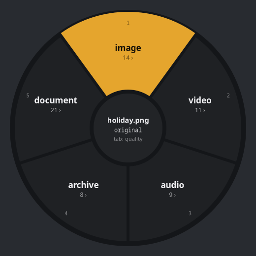
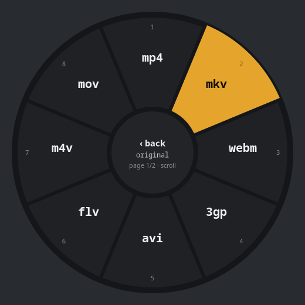

# PiFile

Convert, join, pack and unpack files straight from your Linux file manager.
Middle-click a file in Files (Nautilus), flick the mouse toward a format, done.

<p align="center">
  
  
</p>

PiFile is a single Go binary. It treats formats as a graph and finds the
cheapest chain of tools between any two of them, so a PNG can become an MP3,
a PDF can become an MP4 and a DOCX can become an EPUB. Every pair is tested.

## Features

- **Any format to any format.** About 100 formats across images, RAW photos,
  video, audio, subtitles, PDF, Office and LibreOffice documents, spreadsheets,
  slides, e-books and archives. When no direct tool exists, PiFile chains
  several (`docx → pdf → png → mp4`).
- **Cross-media conversions that mean something.**
  - Image → audio paints the picture into a spectrogram. Convert the sound
    back to an image and the picture reappears.
  - Audio → image draws the spectrogram.
  - Audio → video renders a waveform.
  - Video → audio of a silent clip sonifies its first frame.
  - Image → text runs OCR.
- **Join.** Select several files and combine them:
  - photos into a GIF, MP4, PDF or layered PSD;
  - clips of any size into one video;
  - PDFs into one PDF;
  - tracks into one audio file;
  - anything into one archive.
- **Pack and unpack.** zip, 7z, tar.gz, tar.xz, tar.zst, tar.bz2 and cbz.
  rar, iso and cbr can be extracted. Archives can be repacked from one
  format to another.
- **Radial menu.** Inspired by the old Counter-Strike buy wheel. The
  direction of a short mouse flick picks the wedge, number keys work too.
  Quality presets are one Tab away.
- **Fast.**
  - Files convert in parallel, one job per CPU core.
  - Video is remuxed instead of re-encoded whenever the codecs allow it.
  - The fastest available tool is tried first.
- **Safe.**
  - Originals are never touched.
  - Outputs never overwrite anything: a second run gives `name (2).ext`.
  - Unfinished files never appear next to your files.
- **Unknown files still convert.**
  - To a document: a report with the file type, size, hex dump and all
    readable strings.
  - To audio: the raw bytes played as sound.
  - To an image: the raw bytes drawn as pixels.

## Install

Linux only. One command:

```sh
curl -fsSL https://raw.githubusercontent.com/OppaiHacker/PiFile/main/install.sh | bash
```

Or from a clone:

```sh
git clone https://github.com/OppaiHacker/PiFile.git
cd PiFile
./install.sh        # add -y to accept every default
```

The installer detects your distribution and your file managers. It asks all
questions up front, then:

1. installs the dependencies with your package manager (pacman, apt, dnf or
   zypper);
2. downloads the prebuilt `pifile` from the latest release into
   `~/.local/bin`, checks its SHA-256 and makes sure it runs on your system;
3. adds **Convert…** to the file managers you pick;
4. optionally installs the Nautilus middle-click extension;
5. optionally downloads LibreOffice, pandoc and calibre (about 700 MB, no
   root, stored in `~/.local/share/pifile/engines`) for full-fidelity
   documents.

With the prebuilt release the whole install takes well under a minute.

PiFile needs GLib 2.88 and GTK 4.22 or newer: Arch, Fedora 44, Ubuntu 26.04,
Debian 14 or later. On ARM the installer builds from source instead. The
first build compiles the GTK bindings and takes several minutes.

### Supported file managers

| File manager | How PiFile appears |
| --- | --- |
| Files (Nautilus) 43+ | Middle click on a file, right-click **Convert…**, <kbd>Ctrl</kbd>+<kbd>Shift</kbd>+<kbd>C</kbd> |
| Dolphin | Right-click **Convert…** |
| Thunar | Right-click **Convert…** (custom action) |
| Nemo | Right-click **Convert…** (Nemo action) |
| Caja | Right-click **Scripts › Convert…** |
| PCManFM, PCManFM-Qt | Right-click **Convert…** (file-manager action) |

To add or refresh the entries later, run `pifile install` (every detected
file manager) or `pifile install thunar nemo` (only those).

### Desktop support

- **Wayland with layer-shell:** the radial menu opens as an overlay. This
  covers Hyprland, Sway, KDE Plasma, river and others. On Hyprland it opens
  under the pointer, elsewhere in the middle of the screen.
- **GNOME and X11:** these have no layer-shell, so the same choices open in a
  list picker (rofi, wofi, fuzzel or zenity, whichever is installed).

## Usage

### Radial menu

| Action | Mouse | Keyboard |
| --- | --- | --- |
| Pick a wedge | Click, or flick toward it | <kbd>1</kbd>–<kbd>9</kbd>, <kbd>Enter</kbd> |
| Back / close | Right click, centre | <kbd>Esc</kbd>, <kbd>Backspace</kbd> |
| Next page of formats | Scroll | <kbd>PgDn</kbd>, <kbd>→</kbd> |
| Quality preset | Scroll (on a ring with one page) | <kbd>Tab</kbd> |

The presets are:
- **original:** tool defaults;
- **high:** quality 90;
- **web:** quality 80, at most 1920 px;
- **small:** quality 60, at most 1280 px.

With one file the wheel shows that file's categories. With several files,
**join** and **pack** come first. A notification shows progress, and its
**Show** button opens the result.

### Command line

```sh
pifile convert -to mp3 picture.png          # any file to any format
pifile convert *.heic -to jpg -q 85 -size 1920
pifile join -to pdf scan1.jpg scan2.jpg     # many files into one
pifile join -to mp4 -d 3 *.jpg              # slideshow, 3 s per photo
pifile convert -to extract archive.7z       # unpack
pifile convert -to compress big.pdf         # smaller PDF
pifile targets file.docx                    # what can this become?
pifile watch -to webp -move ~/Screenshots   # convert every new file
pifile tools                                # which engines are installed
```

| Flag | Meaning |
| --- | --- |
| `-to FORMAT` | Target format, or `extract` / `compress` |
| `-q N` | Quality 1–100 |
| `-size N` | Max width/height in px (video: height) |
| `-d SEC` | Seconds per still image in videos (default 2) |
| `-o DIR` | Output folder (default: next to the original) |
| `-j N` | Parallel jobs (default: CPU count) |
| `-move` | `watch`: move originals to `DIR/originals` |

Flags may come before or after the file names. A PDF converted to an image
gives a folder with one image per page.

`pifile drop` opens an invisible wheel that appears when files are dragged
over it. Bind it to a key in your compositor and press the key while
dragging.

## Formats

| Kind | Formats |
| --- | --- |
| Images | jpg, png, webp, avif, heic, jxl, jp2, tiff, gif, bmp, ico, tga, qoi, ppm, pcx, dds, exr, svg (read), psd, xcf (read) |
| RAW photos (read) | dng, cr2, cr3, nef, arw, raf, orf, rw2 |
| Video | mp4, mkv, webm, mov, avi, m4v, flv, wmv, ts, mpg, 3gp, animated gif and webp |
| Audio | mp3, flac, wav, ogg, opus, m4a, aac, wma, aiff |
| Subtitles | srt, ass, vtt |
| Documents | pdf, doc, docx, odt, rtf, txt, html, md, rst, tex, org, ipynb (read), ps and eps (read) |
| Spreadsheets | xls, xlsx, ods, csv |
| Slides | ppt, pptx, odp |
| E-books | epub, mobi, azw3, fb2 |
| Archives | zip, 7z, tar, tar.gz, tar.xz, tar.zst, tar.bz2, cbz; rar, iso and cbr (read) |
| Text and code | json, xml, yaml, toml, ini, log, sh, py, go, js, c, cpp, rs, java, css, sql and more |

Files with a missing or wrong extension are recognised by their content.

## How it works

Each tool is an edge in a graph of formats, with a cost:

- a real tool costs 1;
- PiFile's built-in Office readers and writers cost 3;
- byte-level fallbacks cost 20 or more.

Dijkstra finds the cheapest route from the source format to the target format.
Each hop then tries every tool that can do it, cheapest first, so a missing
or failing tool falls back to the next one. Every hop writes into a hidden
temporary folder next to the output. The result is moved into place with an
atomic rename at the very end.

| Tool | Used for |
| --- | --- |
| [libvips](https://www.libvips.org/) | Fast image conversion and resizing |
| [ImageMagick](https://imagemagick.org/) | PSD, ICO, TGA and other image formats, multi-page output |
| [FFmpeg](https://ffmpeg.org/) | Video, audio, GIF, spectrograms, waveforms |
| [Ghostscript](https://www.ghostscript.com/), [Poppler](https://poppler.freedesktop.org/) | PDF rendering, merging, compression, text |
| [Tesseract](https://github.com/tesseract-ocr/tesseract) | OCR |
| [libarchive](https://libarchive.org/) (`bsdtar`) | Archives |
| [LibreOffice](https://www.libreoffice.org/), [pandoc](https://pandoc.org/), [calibre](https://calibre-ebook.com/) | Optional, full-fidelity documents and e-books |

Without the optional engines, PiFile's own Go code still reads and writes
the following, as plain text without images or styling:
- docx, odt, odp, rtf, html, epub, fb2;
- xlsx and ods;
- MOBI;
- legacy doc, xls and ppt (read only).

## Development

```sh
go build -o pifile .                        # needs gtk4 and gtk4-layer-shell headers
docker run --rm -v "$PWD:/src" ubuntu:26.04 /src/release/build.sh   # release assets into dist/
go test .                                   # fast tests, about 10 s
PIFILE_MATRIX=1 go test -run Matrix .       # every source format to every target, about 35 min
```

The matrix test converts about 40 source formats to every format they can
reach: 2461 conversions. It then checks each result's content, not only that
it exists:
- archives must list;
- PDFs must open;
- audio and video must have a duration;
- images must decode;
- documents must read back with the original text.

The Nautilus extension lives in [`nautilus/`](nautilus/pifile-nautilus.c).
It is a small C module that hands the clicked or selected paths to
`pifile pick`. The build command is at the top of the file.

## Uninstall

```sh
pifile uninstall
```

This removes the binary, the downloaded engines and every **Convert…** entry.
Your own Thunar actions and Nautilus shortcuts stay untouched. The Nautilus
extension sits in a system folder, so its removal asks for your sudo
password. Packages installed by your package manager stay, because other
programs may use them.

## License

PiFile is free software, licensed under the
[GNU General Public License v3.0 or later](LICENSE). You may use, share and
modify it at no cost. Any copy or modified version you distribute must stay
free under the same license, with its source code available.
